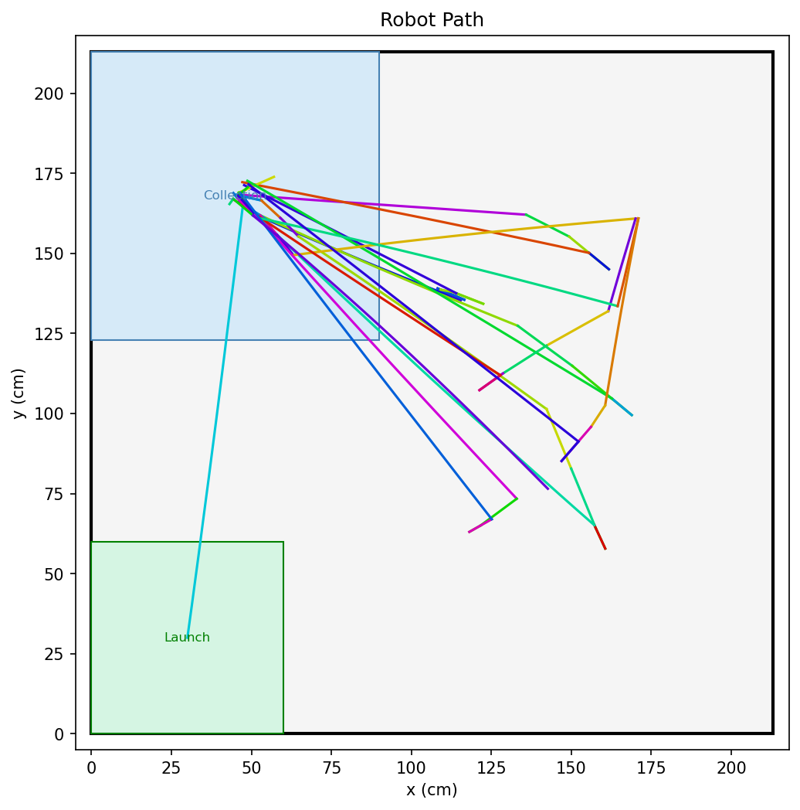
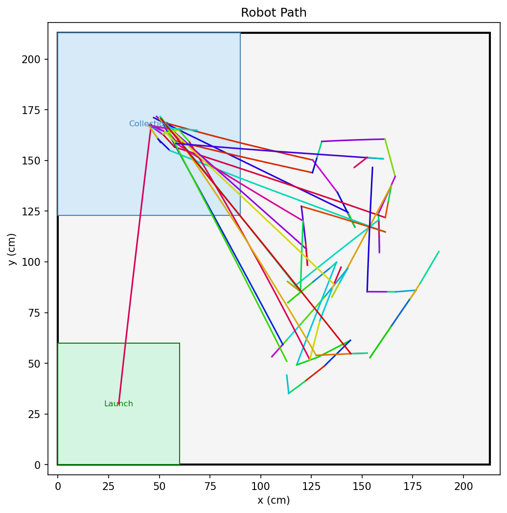

# ENPM 701 Grand Challenge -- Final Project

## Overview

Autonomous Raspberry Pi 4B robot that locates colored blocks (red, green, blue) in a 7x7 ft arena,
picks them up, and delivers them to the NW collection zone. Starts from the SW launch
zone. Uses pigpio for hardware-timed encoder counting and wall-proximity localization.

## Results

Recorded paths from two full runs (launch zone bottom left, collection zone top left):

| Run 1 | Run 2 |
|---|---|
|  |  |

Timelapses with detection overlay: [run 1](timelapse1.mp4), [run 2](timelapse2.mp4).

## Hardware

- `CAD/`: FreeCAD model and printable STL mounts (Pi, camera, gripper, H-bridge, ultrasonic, battery cage)
- `Electrical/`: KiCad schematic and board layout
- `arduino/imu_serial/`: Arduino sketch that streams IMU heading over serial

## Requirements

- Raspberry Pi with pigpiod running (`sudo pigpiod`)
- Dev and test packages: `pip install -r requirements-dev.txt`
- On the Pi, also: `pigpio`, `picamera2` (with libcamera), and `pyserial`

## Running the mission

```bash
sudo pigpiod          # start pigpio daemon if not running
python main.py        # autonomous run
python -m fp          # equivalent
```

## Package layout

```
.
|-- main.py
|-- fp/
|   |-- arena.py        # arena geometry, zone bounds, coordinate math
|   |-- cli.py          # startup, hardware init, run loop
|   |-- fsm.py          # mission state machine
|   |-- hal.py          # pigpio GPIO, motors, encoders, ultrasonic, IMU, servo
|   |-- localization.py # pose tracking, wall-clearance checks
|   |-- mapping.py      # path recording and PNG visualization
|   |-- motion.py       # drive, pivot, localize, approach, grab, release
|   |-- search.py       # grid-based search planner, 360-degree scan
|   \-- vision.py       # camera capture, HSV blob detection
\-- calibration/
    |-- calibrate_camera.py     # compute and save camera intrinsics (checkerboard)
    |-- blob_size.py            # display blob area and centroid readings live
    |-- capture_full_res.py     # capture full-res frames under every AWB mode
    |-- encoder_test.py         # verify encoder counts per revolution
    |-- extract_hsv.py          # polygon-masked HSV range extraction
    |-- hsv_tuner.py            # live trackbar HSV tuner (requires Pi camera)
    |-- hsv_tuner_static.py     # trackbar HSV tuner on a saved JPEG
    |-- make_timelapse.py       # stitch timelapse frames with detection overlay
    |-- ultrasonic_test.py      # print live ultrasonic readings
    \-- vision_sample.py        # capture frame, detect blocks, save masks
```

`tests/` holds the pytest suite; `scripts/verify.sh` runs the checks.

## Running tests

```bash
python -m pytest tests/ -v
```
